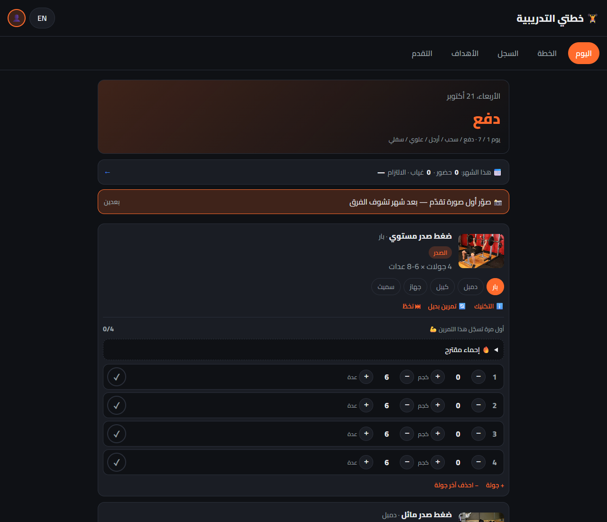

# 🏋️ Gym Planner — خطتي التدريبية

A bilingual (Arabic / English) workout planner and tracker that runs entirely in the browser: pick a training split, see how to do each exercise, log your sets, set goals, and follow your progress — no account, no server.

**Live demo:** [khutati.vercel.app](https://khutati.vercel.app) — works on phones and can be installed as an app.



## Features

- **Training plans** — Push / Pull / Legs / Upper / Lower (my own split), Full Body 3×, and Bro Split, each as a repeating 7-day cycle.
- **Plan editor** — rename days, add / remove / reorder exercises, change sets, reps and equipment, or turn a day into a rest day. Editing a built-in plan makes your own copy, so the original is always one tap away.
- **Today view** — works out which day of the cycle today is from a start date; a "missed today, push one day" button shifts the schedule. Trained yesterday but logged it today? Tap the next day twice: the workout moves to yesterday's date and the schedule shifts.
- **Finish workout** — one button under today's exercises: drops sets you didn't tick, stops the rest timer and turns into a one-line summary (sets, volume, new records, skipped) with undo. Exercises you didn't log fold down to their title.
- **Skip an exercise** — for today only, with an optional reason (no time / pain / machine busy); shown in the summary and history. Or remove it from your plan for good.
- **Exercise choices** — 31 movements with 85 equipment variants (barbell, dumbbell, cable, machine, Smith…). Change the equipment or swap to another exercise for the same muscle; choices are remembered.
- **Technique window** — a 2-frame animation of the movement, a front/back body map (polygon body model) that highlights the target muscle (strong) and helper muscles (light), short technique tips, and an embedded YouTube tutorial for every exercise in my plan (search button for the rest).
- **Set logging** — weight and reps with − / + buttons, ✓ per set, auto-filled from the last time you did the same exercise with the same equipment.
- **Rest timer** — starts when a set is ticked, with −15 / +15 / skip; vibrates and beeps when rest is over. The default length is a setting.
- **Plate calculator** — under every barbell / EZ-bar set: which plates go on each side (e.g. 85 kg → 25 + 5 + 2.5), with a setting for the bar weight.
- **Warm-up calculator** — for big lifts, suggested warm-up sets from your first set's weight (empty bar × 10 → 50% × 5 → 70% × 3 → 85% × 1), rounded to loadable weights, with plates.
- **Personal records** — a gold banner when a ticked set beats your heaviest weight, your estimated one-rep max, or your reps at that weight; the technique window lists your records per exercise.
- **History** — every workout by date, editable; two-tap delete.
- **Goals** — lift a target weight, reach a body weight, or train N times a week. Progress is computed from the log, measured from the starting point; input is checked against realistic ranges.
- **Me page** — your name, a greeting and a profile photo (in the top corner). Holds your profile and advice: BMI (with its limits explained), estimated daily calories, protein and water, a tip for your age, and whether a body-weight goal's deadline is a safe pace.
- **Progress photos** — add a photo (camera or gallery), saved with the date and your weight; compare any two side by side with the time and weight change between them; a monthly reminder in the Today tab; a separate backup file for the photos. Photos never leave the device.
- **Progress** — summary tiles, weekly sets per muscle on the body map (low / good / high), top-weight-per-workout chart with estimated one-rep max (Epley), a 6-month attendance heatmap (attended / missed / off days) with a monthly table, and a body-weight chart.
- **Your data** — save a backup file, restore it on another device, or download your log as a CSV table for Excel / pandas. Restoring checks every field first.
- **Installable app (PWA)** — add it to your home screen; it opens offline and keeps your plan's exercise images.

## Tech stack

- HTML, CSS, vanilla JavaScript (no framework, no build step)
- [Chart.js 4.4.1](https://www.chartjs.org/) for charts
- `localStorage` for data, `IndexedDB` for progress photos
- Service Worker + Web App Manifest for offline / install
- Python (Pillow) to draw the app icons; a small Python script to build the exercise list from the open dataset

## How it works

- **Data files** (`data/`) describe *what* exists: movements and their equipment variants, the plans, and the video ids. The code in `js/` only reads them, so adding an exercise or a plan doesn't need code changes.
- **The cycle**: `day of cycle = (days since start date) mod 7`, with a fix so dates before the start never give a negative number.
- **User choices are stored separately** from the plan template (`"ppl_ul|0|2" → { movement, equip }`), so "back to original" is one click and the template stays untouched.
- **The log** is keyed by date, and inside each day by `movement.equipment` — 25 kg on dumbbells is not 25 kg on a barbell. "Last time" = the most recent earlier date that has the same key.
- **Derived values are never stored**: goal progress, attendance, BMI and charts are recalculated from the log every time, so editing or deleting a workout fixes everything automatically.
- **Attendance**: a past training day with nothing logged counts as missed; rest days are never counted; today isn't counted until it's over. Commitment = attended training days ÷ (attended + missed).
- **Offline**: the service worker uses *network-first* (with `cache: "no-cache"`, so the browser's own HTTP cache can't serve an old file) for the app's own files and *cache-first* for images, fonts and the chart library (they never change).
- **Rest timer** stores the *end time* instead of counting down, so it stays right even when the phone throttles a background page.
- **Plate calculator** is a greedy algorithm (heaviest plate that fits, repeat). With standard plates each plate is a multiple of the next smaller one, so greedy gives the fewest plates.
- **Records** are computed from the log on each ✓; the first time you ever do an exercise there's nothing to beat, so no banner.
- **Weekly sets per muscle**: each finished set counts 1 for the exercise's main muscle and 0.5 for each helper muscle; 10–20 sets a week is shown as a general guideline.
- **Plan editing is copy-on-write**: the built-in templates are never changed; your edited copy (with your swaps baked in) lives in `localStorage`.
- **Skipped exercises are stored apart from the log** (`skips` by date), so a day where you only skipped things never counts as a workout day in attendance or goals.
- **Photos** are shrunk in the browser before saving (canvas → JPEG, longest side 1080 px; the profile photo is a 160 px square), so a 4 MB phone photo becomes ~150 KB. They go in IndexedDB because `localStorage` holds only ~5 MB of text. On-screen photos use temporary `blob:` links that are freed on every redraw.

## Security

A technical review of the code found real problems, which are now fixed:

- **XSS** — text you type (plan / day names) or that comes from an imported file is escaped (`esc()`) before it goes into the page.
- **Backup import** — every field is checked (types, realistic ranges, exercise ids that exist, no `__proto__` keys) before anything is saved; photo backups are checked the same way.
- **Broken or full storage** — a corrupted value no longer blanks the page: it's kept aside as `broken_<key>` and the app starts that part fresh. If the browser refuses to save, a red bar says so.
- **Security headers** (`vercel.json`) — a Content-Security-Policy that only allows scripts from the site and cdnjs, plus `nosniff`, no framing, and camera / microphone / location turned off.
- **Subresource Integrity** on Chart.js — the browser refuses the file if the CDN copy ever changes.
- **Offline fallback** — only page visits fall back to the start page; a missing script fails as a normal error.

## Project structure

```
gym-planner/
├── index.html              # page skeleton: 5 tabs + Me page + exercise dialog
├── vercel.json             # security headers (CSP etc.)
├── manifest.webmanifest    # app name, icons, colors (PWA)
├── sw.js                   # service worker (offline cache)
├── css/style.css           # dark theme, RTL/LTR layout
├── data/
│   ├── exercises.js        # MUSCLES, EQUIPMENT, MOVEMENTS (+ variants)
│   ├── splits.js           # the 3 training plans
│   ├── videos.js           # YouTube video ids per movement
│   └── body-model.js       # front/back body polygons (body-highlighter, MIT)
├── js/
│   ├── storage.js          # localStorage with a "gp_" prefix (+ moves old keys)
│   ├── i18n.js             # Arabic / English texts + language switch
│   ├── bodymap.js          # SVG muscle map
│   ├── log.js              # set logging, skipped exercises, history
│   ├── goals.js            # goals + body weight
│   ├── profile.js          # profile + personal advice
│   ├── charts.js           # Progress tab (tiles + Chart.js)
│   ├── calendar.js         # attendance heatmap + monthly summary
│   ├── backup.js           # backup / restore / CSV export
│   ├── timer.js            # rest timer
│   ├── plates.js           # plate calculator
│   ├── warmup.js           # warm-up calculator
│   ├── records.js          # personal records
│   ├── volume.js           # weekly sets per muscle
│   ├── editor.js           # plan editor (custom plans)
│   ├── finish.js           # finish-workout button + summary
│   ├── me.js               # Me page: name, greeting, profile photo
│   ├── photos.js           # progress photos (IndexedDB), reminder, photo backup
│   ├── app.js              # tabs, plan, today, exercise dialog
│   └── pwa.js              # service worker registration + install button
├── docs/feature-ideas.md   # competitor research and feature backlog
├── icons/                  # app icons (192, 512, maskable, favicon)
└── screenshots/
```

## Run locally

```bash
cd gym-planner
python -m http.server 5501
```

Then open http://localhost:5501. A local server is needed (not double-clicking `index.html`) because the service worker only runs on `http://localhost` or `https://`.

## Limitations (honest notes)

- **Data stays on one device/browser.** There's no account or sync; use "Save a copy of my data" (and "Save my photos") to move it. Clearing the browser's data deletes everything, photos included.
- **Internet is needed the first time** (exercise images, chart library, fonts) and always for YouTube videos.
- **Off days in the attendance map come from the current plan.** If you switch plans, past months are shown against the new plan.
- **Sets, reps and tips are general guidance** I wrote for my own training, not advice from a coach. Calories, BMI and protein use standard formulas and are estimates, not medical advice.
- 22 of the 31 movements have a hand-picked video; the other 9 open a YouTube search instead.
- The rest timer can only vibrate / beep while the screen is on — browsers pause web pages on a locked phone.
- No plate calculator for Smith machines, because their bar weight differs from gym to gym.
- The body model has one "upper back" shape, so lats and middle back share it (it shows the larger value).
- No automated tests yet — features were checked manually in the browser, including offline with the server stopped and with the security headers served locally. Tests are the next step.

## Credits

- Exercise images and muscle data: [free-exercise-db](https://github.com/yuhonas/free-exercise-db) (public domain / Unlicense)
- Technique videos: [ScottHermanFitness](https://www.youtube.com/@ScottHermanFitness) on YouTube (embedded, not re-hosted)
- Body / muscle map shapes: [body-highlighter](https://github.com/lahaxearnaud/body-highlighter) by GV79 (MIT)
- Charts: [Chart.js](https://www.chartjs.org/) (MIT) · Font: [Cairo](https://fonts.google.com/specimen/Cairo) (OFL)

## Author

**Ahmed Maher Algaoni** — Computer Science student at Qassim University, aspiring Data Analyst.
GitHub: [@1jjl7](https://github.com/1jjl7) · Portfolio: [1jjl7.github.io](https://1jjl7.github.io)

Built step by step with [Claude Code](https://claude.com/claude-code) as a learning project.
